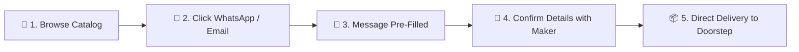

# 🥒 Mompie Pickle – Authentic Homemade Pickles

<div align="center">


### Traditional Taste of Assam, Handcrafted with Love & Pure Ingredients ✨

[](https://github.com)
[](https://github.com)
[](https://github.com)
[](https://vercel.com)
[](LICENSE)

[**Explore Pickles**](#-signature-pickles-menu) • [**Quick Start**](#-getting-started) • [**Order Flow**](#-how-ordering-works) • [**Deployment**](#-deployment) • [**Contact Us**](#-contact--support)

</div>

---

## 📖 Overview

**Mompie Pickle** is an elegant, high-performance static web platform designed for an artisanal homemade pickle business rooted in Assam, India. 

The website delivers a mouth-watering digital catalog showcasing authentic Assamese culinary traditions—from savory pork and chicken pickles to rare regional delicacies like crispy bamboo shoots, ghost pepper (*Bhoot Jolokia*), wild jujube (*Meetha Bogori*), and Indian olive (*Jalphai*).

Built with a **zero-overhead, serverless architecture**, it eliminates complex checkout carts, account registrations, and database dependencies in favor of **direct, personalized ordering via WhatsApp and Email**.

---

## ✨ Key Features

### 🎨 Visual & User Experience (UX)
* **Mobile-First Responsive Layout:** Flawless experience across smartphones, tablets, laptops, and ultra-wide screens.
* **Hero Background Slider:** Seamless infinite carousel with auto-play, touch swipe detection, navigation dots, arrow controls, and hover-to-pause.
* **Smooth Micro-Interactions:** Modern scroll-reveal animations driven by the browser's native `IntersectionObserver` API.
* **Sticky Navigation & Off-Canvas Drawer:** Adaptive glassmorphism navigation header paired with a smooth touch-friendly mobile drawer menu.
* **Rich Visual Cards:** Product cards featuring badges (*Best Seller*, *Extra Hot*), imagery, and instant order triggers.

### 📲 Frictionless Direct-Order Workflow
* **Instant WhatsApp Ordering:** Product cards feature direct click-to-chat links with pre-filled order messages (`https://wa.me/...`).
* **Pre-composed Email Orders:** Direct `mailto:` actions with subject lines pre-configured for each specific pickle variety.
* **Zero Cart Abandonment:** No login friction, no password fatigue, and no multi-step checkout hurdles.

### ⚡ Performance & Production Ready
* **Ultra-Fast Static Footprint:** Zero heavy JS frameworks; loads in milliseconds.
* **Asset Caching Configured:** Pre-configured `vercel.json` with 1-year immutable caching rules for images, stylesheets, and scripts.
* **Built-in PowerShell Web Server:** Includes `start-server.ps1` for local zero-dependency testing on Windows.

---

## 🌶️ Signature Pickles Menu

| Pickle Variety | Flavor Profile | Highlights | Order Action |
| :--- | :--- | :--- | :---: |
| **Spicy Pork Pickle** | Rich, savory, spiced pork slow-cooked to perfection | ⭐ **Best Seller** | [WhatsApp / Email](#-contact--support) |
| **Authentic Chicken Pickle** | Juicy shredded chicken infused with ethnic Assamese spices | Signature Non-Veg | [WhatsApp / Email](#-contact--support) |
| **Traditional Mixed Veg Pickle** | Seasonal vegetables, raw mango chunks, and aromatic mustard | Tangy & Crunchy | [WhatsApp / Email](#-contact--support) |
| **Lemon Khatta Meetha Pickle** | Sun-cured sweet and sour zesty lemons | Timeless Classic | [WhatsApp / Email](#-contact--support) |
| **Crispy Bamboo Shoot Pickle** | Tender young bamboo shoots in pure mustard oil and fenugreek | Authentic Assam Aroma | [WhatsApp / Email](#-contact--support) |
| **Fiery Bhoot Jolokia Pickle** | Legendary Assam Ghost Peppers cured with mustard oil & spices | 🔥 **Extra Hot** | [WhatsApp / Email](#-contact--support) |
| **Sweet Meetha Bogori Pickle** | Wild Assam jujube berries slow-simmered with organic jaggery | Sweet, Sour & Tangy | [WhatsApp / Email](#-contact--support) |
| **Traditional Jalphai Pickle** | Fresh Indian olives seasoned with crushed mustard seeds | Traditional Relish | [WhatsApp / Email](#-contact--support) |

---

## 📁 Project Structure

```plaintext
Pompie pickle/
│
├── index.html              # Main HTML5 landing page & product catalog
├── vercel.json             # Vercel deployment & static asset cache headers
├── start-server.ps1        # Built-in PowerShell HTTP server for local testing
├── README.md               # Project documentation & reference
│
├── css/
│   └── style.css           # Custom CSS styling, variables, flex/grid, and animations
│
├── js/
│   └── script.js           # Slider logic, mobile drawer, scroll animations, and events
│
└── assets/
    └── images/             # Product photography, logo, and hero banners
        ├── logo.png
        ├── hero_bg.png
        ├── hero_bg1.png
        ├── hero_bg2.png
        ├── pork.png
        ├── chicken.png
        ├── veg.png
        ├── lemon.png
        ├── bamboo.png
        ├── Bhut jolokia.png
        ├── meetha bogori.png
        └── jalphai.png
```

---

## 🛠️ Built With

* **HTML5:** Semantic markup structured for accessibility and search engine optimization.
* **CSS3:** Custom properties (CSS variables), CSS Grid, Flexbox, glassmorphic headers, and keyframe transitions.
* **JavaScript (ES6+):** Pure Vanilla JS powering the infinite carousel, observer transitions, and drawer navigation.
* **Google Fonts:** [Outfit](https://fonts.google.com/specimen/Outfit) (Clean modern body font) and [Playfair Display](https://fonts.google.com/specimen/Playfair+Display) (Editorial serif headlines).
* **Font Awesome 6:** Vector iconography for actions, buttons, and navigation.

---

## 🚀 Getting Started

You can run this project locally using any of the following methods without installing heavy dependencies:

### Method 1: Built-in PowerShell Local Server (Recommended for Windows)

The project includes an automatic HTTP server script that finds an open port, serves the assets with correct MIME types, and opens your default browser automatically.

1. Open PowerShell in the project directory:
   ```powershell
   cd "d:\Projects\Pompie pickle"
   ```
2. Execute the script:
   ```powershell
   .\start-server.ps1
   ```
3. The site will immediately open at `http://localhost:5000/`.
4. Press `Ctrl + C` in the PowerShell window when you are done.

---

### Method 2: Python HTTP Server

If Python is installed on your machine:

```bash
# Python 3.x
python -m http.server 5000
```
Open [http://localhost:5000](http://localhost:5000) in your browser.

---

### Method 3: Node.js (npx serve)

If Node.js is installed:

```bash
npx serve .
```

---

### Method 4: Direct Browser Launch

Since this is a client-side static web application, you can also double-click `index.html` to open it directly in Google Chrome, Microsoft Edge, Mozilla Firefox, or Safari.

---

## 🔄 How Ordering Works



1. **Browse:** Customers explore product photos, ingredients, spice indicators, and descriptions.
2. **Select & Tap:** Clicking "WhatsApp" opens a chat window directly with Mompie Pickle with the item name pre-populated.
3. **Confirm:** The customer provides quantity and delivery address directly in the chat.
4. **Fulfillment:** Orders are prepared fresh in small batches and dispatched directly.

---

## 🌐 Deployment

### Deploying to Vercel

The repository contains a pre-configured `vercel.json` file. To deploy:

1. Push or upload your repository to GitHub / GitLab / Bitbucket.
2. Import the project into [Vercel](https://vercel.com).
3. Framework Preset: **Other** (Static Site).
4. Click **Deploy**.

Asset caching headers are already configured for maximum performance:
* Images, CSS, and JS files have `Cache-Control: public, max-age=31536000, immutable`.
* Clean URLs enabled.

### Deploying to GitHub Pages

1. Navigate to **Repository Settings** > **Pages**.
2. Select `main` (or `master`) branch as the source folder `/ (root)`.
3. Click **Save**. Your site will be published at `https://<username>.github.io/<repo-name>/`.

---

## 📞 Contact & Support

For orders, custom requests, bulk inquiries, or collaborations:

* **WhatsApp:** [+91 60036 56338](https://wa.me/916003656338)
* **Email:** [chanchaltaye18@gmail.com](mailto:chanchaltaye18@gmail.com)
* **Location:** Assam, India

---

## 📄 License

This project is open-source and available under the [MIT License](LICENSE).

<div align="center">
Made with ❤️ for authentic homemade Assamese flavors.
</div>
